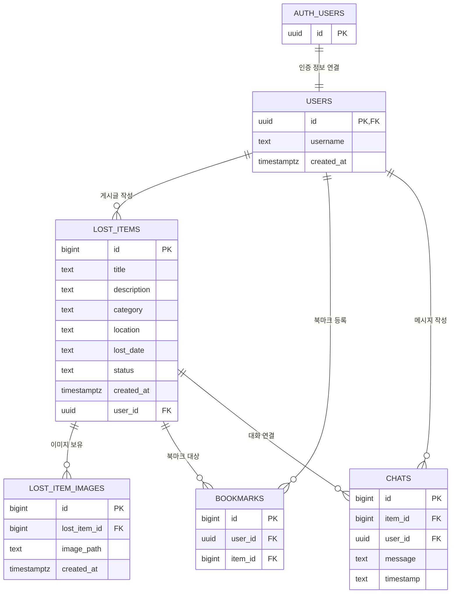

# Supabase 데이터베이스 설정 가이드

PKNU Finder 프로젝트에서 사용하는 Supabase 데이터베이스의 생성 및 설정 방법을 안내합니다.

이 문서는 Supabase를 처음 사용하는 팀원 또는 기여자도 동일한 데이터베이스 환경을 구성할 수 있도록 작성되었습니다.

## 목차

1. [Supabase 가입 및 프로젝트 생성](#1-supabase-가입-및-프로젝트-생성)
2. [프로젝트 API 정보 확인](#2-프로젝트-api-정보-확인)
3. [데이터베이스 테이블 생성](#3-데이터베이스-테이블-생성)
4. [테이블 관계 확인](#4-테이블-관계-확인)
5. [RLS(Row Level Security) 설정](#5-rlsrow-level-security-설정)
6. [Supabase Storage 설정](#6-supabase-storage-설정)
7. [Authentication 설정](#7-authentication-설정)
8. [프로젝트 환경 변수 설정](#8-프로젝트-환경-변수-설정)
9. [데이터베이스 연결 확인](#9-데이터베이스-연결-확인)
10. [주의 사항](#10-주의-사항)

---

## 1. Supabase 가입 및 프로젝트 생성

### 1-1. Supabase 가입

Supabase는 PostgreSQL 기반의 데이터베이스와 사용자 인증, 파일 저장소 등의 기능을 제공하는 서비스입니다.

1. [Supabase 공식 홈페이지](https://supabase.com/)에 접속합니다.
2. **Start your project** 또는 회원가입 버튼을 클릭합니다.
3. GitHub 계정 또는 이메일을 이용하여 회원가입을 진행합니다.
4. 가입이 완료되면 Supabase Dashboard에 접속합니다.

### 1-2. Organization 생성

Supabase 프로젝트를 관리할 Organization을 생성합니다.

1. Dashboard에서 Organization 생성 메뉴를 선택합니다.
2. Organization 이름을 입력합니다.
   - 예시: `PKNU-Finder`
3. 적절한 요금제를 선택합니다.
4. Organization 생성을 완료합니다.

### 1-3. 프로젝트 생성

Organization 생성 후 데이터베이스 프로젝트를 생성합니다.

1. **New Project** 버튼을 클릭합니다.
2. 다음 정보를 입력합니다.

| 항목 | 설정 예시 |
|---|---|
| Project Name | pknu-finder |
| Database Password | 직접 생성한 안전한 비밀번호 |
| Region | Northeast Asia (Seoul) 등 가까운 지역 |
| Pricing Plan | 프로젝트 상황에 맞는 요금제 |

3. Database Password는 별도로 안전하게 보관합니다.
4. **Create new project** 버튼을 클릭합니다.
5. 프로젝트 생성이 완료될 때까지 기다립니다.

`Database Password는 PostgreSQL 데이터베이스에 직접 접속할 때 사용하는 비밀번호입니다. 프로젝트의 API Key와는 다른 정보이므로 혼동하지 않도록 합니다.`


---

## 2. 프로젝트 API 정보 확인

Streamlit 애플리케이션이 Supabase에 연결하려면 프로젝트 URL과 API Key가 필요합니다.

### 2-1. Project URL 확인

1. Supabase Dashboard에서 생성한 프로젝트를 선택합니다.
2. **Project Overview**로 이동합니다.
3. 프로젝트 명 아래에 위치한 Project URL을 확인합니다.
4. 해당 URL을 복사합니다.

예시:

```text
https://abcdefghijklmnop.supabase.co
```

### 2-2. API Key 확인

같은 설정 화면에서 API Key를 확인합니다.

프로젝트에서 사용하는 주요 키는 다음과 같습니다.

| 키 | 용도 |
|---|---|
| Publishable Key | 일반적인 클라이언트 요청에 사용하는 공개 키 |
| Secret Key | 서버 측에서 높은 권한이 필요한 작업에 사용하는 비밀 키 |
| Legacy `anon` Key | 기존 공개 API Key |
| Legacy `service_role` Key | 서버 측 관리자 작업에 사용하는 높은 권한의 비밀 키 |

현재 프로젝트의 기존 설정에서는 `SUPABASE_ANON_KEY`와 `SUPABASE_SERVICE_ROLE_KEY` 등의 환경 변수명을 사용하고 있습니다.


- `service_role` 또는 `Secret Key`는 RLS 정책을 우회할 수 있는 높은 권한의 키입니다. GitHub 저장소, 프론트엔드 코드, 사용자에게 노출되는 화면 등에 절대 공개하면 안 됩니다.

---

## 3. 데이터베이스 테이블 생성

PKNU Finder에서는 사용자 정보 `users`, 분실물 게시글 `lost_items`, 이미지 경로 `lost_item_images`, 북마크 `bookmarks`, 채팅 정보 `chats`를 관리합니다.

테이블은 Supabase Dashboard의 SQL Editor에서 SQL 명령어를 실행하여 생성합니다.

### 3-1. SQL Editor 접속

1. Supabase Dashboard에서 프로젝트를 선택합니다.
2. 왼쪽 메뉴에서 **SQL Editor**를 클릭합니다.
3. **New Query**를 클릭합니다.
4. 아래 SQL을 입력합니다.
5. **Run** 버튼을 클릭합니다.

### 3-2. users 테이블

사용자 계정의 기본 정보를 저장하는 테이블입니다.

Supabase Authentication에서 관리하는 사용자 ID와 연결하여 사용합니다.

| 컬럼 | 자료형 | 제약 조건 | 설명 |
|---|---|---|---|
| id | UUID | PK, FK | Supabase Auth 사용자 ID |
| username | TEXT | NOT NULL | 사용자 이름 |
| created_at | TIMESTAMPTZ | DEFAULT NOW() | 계정 생성 시각 |

```sql
CREATE TABLE public.users (
    id UUID PRIMARY KEY REFERENCES auth.users(id),
    username TEXT NOT NULL,
    created_at TIMESTAMPTZ DEFAULT NOW()
);
```

**중요 사항**

- 사용자의 실제 인증 정보는 `auth.users`에서 관리합니다.
- `public.users`는 서비스에서 필요한 사용자 정보를 관리하기 위한 테이블입니다.
- `users.id`에는 Supabase Auth에서 발급한 UUID를 사용합니다.
- 별도의 숫자형 사용자 ID를 발급하여 사용자를 관리하지 않습니다.

### 3-3. lost_items 테이블

분실물 및 습득물 게시글을 저장하는 테이블입니다.

| 컬럼 | 자료형 | 제약 조건 | 설명 |
|---|---|---|---|
| id | BIGINT | PK, IDENTITY | 게시글 고유 ID |
| title | TEXT | NOT NULL | 게시글 제목 |
| description | TEXT | - | 상세 설명 |
| category | TEXT | NOT NULL | 물품 카테고리 |
| location | TEXT | - | 분실 또는 습득 장소 |
| lost_date | TEXT | - | 분실 또는 습득 날짜 |
| status | TEXT | DEFAULT '습득' | 게시글 상태 |
| created_at | TIMESTAMPTZ | DEFAULT NOW() | 게시글 작성 시각 |
| user_id | UUID | FK | 게시글 작성자 ID |

```sql
CREATE TABLE public.lost_items (
    id BIGINT GENERATED ALWAYS AS IDENTITY PRIMARY KEY,
    title TEXT NOT NULL,
    description TEXT,
    category TEXT NOT NULL,
    location TEXT,
    lost_date TEXT,
    status TEXT DEFAULT '습득',
    created_at TIMESTAMPTZ DEFAULT NOW(),
    user_id UUID REFERENCES public.users(id)
);
```

**주요 사항**

- `id`는 게시글마다 자동으로 생성되는 고유 번호입니다.
- `user_id`는 게시글을 작성한 사용자의 UUID입니다.
- `status`의 기본값은 `습득`입니다.
- `user_id`를 통해 게시글 작성자와 사용자 정보를 연결합니다.

### 3-4. lost_item_images 테이블

게시글에 첨부된 이미지의 경로를 저장하는 테이블입니다.

이미지 파일 자체를 데이터베이스에 저장하지 않고, Supabase Storage `lost-item-images`에 업로드한 뒤 해당 파일의 경로만 저장합니다.

| 컬럼 | 자료형 | 제약 조건 | 설명 |
|---|---|---|---|
| id | BIGINT | PK, IDENTITY | 이미지 데이터 고유 ID |
| lost_item_id | BIGINT | FK, NOT NULL | 연결된 게시글 ID |
| image_path | TEXT | NOT NULL | Storage에 저장된 이미지 경로 |
| created_at | TIMESTAMPTZ | DEFAULT NOW() | 이미지 등록 시각 |

```sql
CREATE TABLE public.lost_item_images (
    id BIGINT GENERATED ALWAYS AS IDENTITY PRIMARY KEY,
    lost_item_id BIGINT NOT NULL
        REFERENCES public.lost_items(id)
        ON DELETE CASCADE,
    image_path TEXT NOT NULL,
    created_at TIMESTAMPTZ DEFAULT NOW()
);
```

**주요 사항**

- 하나의 게시글에 여러 이미지를 등록할 수 있습니다.
- `lost_item_id`를 이용하여 게시글과 이미지를 연결합니다.
- 게시글이 삭제되면 연결된 이미지 경로 데이터도 함께 삭제됩니다.
- 실제 이미지 파일은 Supabase Storage에서 별도로 관리합니다.

### 3-5. bookmarks 테이블

사용자가 관심 있는 게시글을 북마크한 정보를 저장합니다.

| 컬럼 | 자료형 | 제약 조건 | 설명 |
|---|---|---|---|
| id | BIGINT | PK, IDENTITY | 북마크 고유 ID |
| user_id | UUID | FK, NOT NULL | 북마크한 사용자 ID |
| item_id | BIGINT | FK, NOT NULL | 북마크한 게시글 ID |

```sql
CREATE TABLE public.bookmarks (
    id BIGINT GENERATED ALWAYS AS IDENTITY PRIMARY KEY,
    user_id UUID NOT NULL REFERENCES public.users(id),
    item_id BIGINT NOT NULL REFERENCES public.lost_items(id)
);
```

**주요 사항**

- 사용자와 게시글의 관계를 관리합니다.
- `user_id`는 북마크를 등록한 사용자입니다.
- `item_id`는 북마크 대상 게시글입니다.

### 3-6. chats 테이블

게시글과 관련된 사용자 간의 채팅 메시지를 저장합니다.

| 컬럼 | 자료형 | 제약 조건 | 설명 |
|---|---|---|---|
| id | BIGINT | PK, IDENTITY | 메시지 고유 ID |
| item_id | BIGINT | FK, NOT NULL | 관련 게시글 ID |
| user_id | UUID | FK, NOT NULL | 메시지 작성자 ID |
| message | TEXT | NOT NULL | 메시지 내용 |
| timestamp | TEXT | DEFAULT NOW() | 메시지 작성 시각 |

```sql
CREATE TABLE public.chats (
    id BIGINT GENERATED ALWAYS AS IDENTITY PRIMARY KEY,
    item_id BIGINT NOT NULL REFERENCES public.lost_items(id),
    user_id UUID NOT NULL REFERENCES public.users(id),
    message TEXT NOT NULL,
    timestamp TEXT DEFAULT NOW()::TEXT
);
```

**주요 사항**

- `item_id`를 이용하여 어떤 게시글과 관련된 대화인지 구분합니다.
- `user_id`를 통해 메시지 작성자를 확인합니다.
- 메시지 작성 시각은 `timestamp`에 저장합니다.

---

## 4. 테이블 관계 확인

PKNU Finder의 데이터베이스는 다음과 같은 관계로 구성됩니다.



### 관계 설명

| 관계 | 설명 |
|---|---|
| auth.users ↔ users | Supabase Auth 사용자와 서비스 사용자 정보 연결 |
| users → lost_items | 한 사용자가 여러 게시글 작성 가능 |
| lost_items → lost_item_images | 한 게시글에 여러 이미지 등록 가능 |
| users → bookmarks | 한 사용자가 여러 게시글 북마크 가능 |
| lost_items → bookmarks | 하나의 게시글을 여러 사용자가 북마크 가능 |
| users → chats | 한 사용자가 여러 메시지 작성 가능 |
| lost_items → chats | 하나의 게시글에 여러 메시지 연결 가능 |

---

## 5. RLS(Row Level Security) 설정

RLS는 데이터베이스의 행 단위 접근 권한을 제어하는 보안 기능입니다.

예를 들어 로그인한 사용자가 자신의 북마크만 조회하거나, 다른 사용자의 게시글을 임의로 수정하지 못하도록 제한할 수 있습니다.

### 5-1. RLS 활성화

SQL Editor에서 다음 SQL을 실행합니다.

```sql
ALTER TABLE public.users ENABLE ROW LEVEL SECURITY;
ALTER TABLE public.lost_items ENABLE ROW LEVEL SECURITY;
ALTER TABLE public.lost_item_images ENABLE ROW LEVEL SECURITY;
ALTER TABLE public.bookmarks ENABLE ROW LEVEL SECURITY;
ALTER TABLE public.chats ENABLE ROW LEVEL SECURITY;
```

### 5-2. RLS 활성화 상태 확인

다음 SQL을 실행하면 각 테이블의 RLS 활성화 여부를 확인할 수 있습니다.

```sql
SELECT
    tablename,
    rowsecurity
FROM pg_tables
WHERE schemaname = 'public'
ORDER BY tablename;
```

`rowsecurity` 값이 `true`이면 해당 테이블의 RLS가 활성화된 것입니다.

### 5-3. RLS 정책 설정 시 주의 사항

RLS를 활성화하는 것만으로 모든 사용자에게 접근 권한이 부여되는 것은 아닙니다.

각 테이블의 작업 방식에 따라 SELECT, INSERT, UPDATE, DELETE 정책을 별도로 설정해야 합니다.

PKNU Finder에서 고려해야 할 정책은 다음과 같습니다.

| 테이블 | 정책 방향 |
|---|---|
| users | 로그인한 사용자는 자신의 사용자 정보만 조회 및 수정 |
| lost_items | 게시글 조회는 서비스 공개 범위에 맞게 허용하고, 수정 및 삭제는 작성자 중심으로 제한 |
| lost_item_images | 연결된 게시글의 접근 권한과 이미지 접근 권한을 일치시킴 |
| bookmarks | 본인의 북마크만 조회, 등록, 삭제 |
| chats | 관련 게시글의 대화 참여자만 조회 및 작성할 수 있도록 제한 |

**위 표는 정책 설계 방향입니다. 추후 개발에 따라 달라질 수 있습니다.**

현재 PKNU Finder는 Streamlit 서버에서 Supabase 클라이언트를 이용해 데이터베이스 작업을 수행합니다. 특히 `service_role` 키를 사용하는 요청은 RLS를 우회할 수 있으므로, RLS만으로 사용자별 권한이 보장된다고 생각하면 안 됩니다. 서버 코드에서도 로그인 사용자와 요청 대상의 소유 관계를 확인해야 합니다.

---

## 6. Supabase Storage 설정

PKNU Finder는 게시글에 첨부되는 이미지를 Supabase Storage에 저장합니다.

### 6-1. Storage Bucket 생성

1. Supabase Dashboard에서 프로젝트를 선택합니다.
2. 왼쪽 메뉴에서 **Storage**를 클릭합니다.
3. **New Bucket**을 선택합니다.
4. 다음과 같이 설정합니다.

| 항목 | 설정 |
|---|---|
| Bucket Name | `lost-item-images` |
| Public Bucket | OFF (Private) |

5. Bucket 생성을 완료합니다.

<주의>
Bucket을 Private으로 설정하면 공개 URL만으로 파일에 접근할 수 없습니다. 이미지 조회 시 인증된 요청 또는 유효한 Signed URL을 사용하는 방식이 필요합니다.
</주의>

### 6-2. 이미지 저장 구조

이미지 파일은 Storage에 저장하고, 이미지 경로는 `lost_item_images` 테이블에 저장합니다.

예시:

```text
Supabase Storage
└── lost-item-images
    ├── 1
    │   ├── image_1.jpg
    │   └── image_2.jpg
    └── 2
        └── image_1.jpg
```

데이터베이스에는 다음과 같이 저장됩니다.

| id | lost_item_id | image_path |
|---|---|---|
| 1 | 1 | `1/image_1.jpg` |
| 2 | 1 | `1/image_2.jpg` |
| 3 | 2 | `2/image_1.jpg` |

### 6-3. Storage 접근 권한

Private Bucket은 파일 업로드, 조회, 삭제에 필요한 접근 정책을 별도로 검토해야 합니다.

현재 프로젝트에서는 서버 측 관리자 클라이언트를 이용한 업로드 방식을 사용하고 있습니다. 따라서 관리자 키가 노출되지 않도록 주의하고, 서버 코드에서 로그인 사용자와 게시글 작성자의 권한을 확인해야 합니다.

또한 게시글이 삭제되면 `lost_item_images`의 DB 레코드는 `ON DELETE CASCADE`에 의해 삭제되지만, Storage에 저장된 실제 파일까지 자동으로 삭제되는 것은 아닙니다.

따라서 게시글 삭제 기능을 구현할 때는 Storage 파일도 별도로 삭제하는 처리가 필요합니다.

**추후 개발 후 수정 될 사항**

---

## 7. Authentication 설정

PKNU Finder는 Supabase Authentication을 이용하여 사용자 인증을 처리합니다.

### 7-1. 이메일 인증 설정

1. Supabase Dashboard에서 **Authentication** 메뉴로 이동합니다.
2. **Sign In / Providers** 또는 Providers 설정 화면을 엽니다.
3. Email Provider가 활성화되어 있는지 확인합니다.
4. 이메일 인증 사용 여부를 프로젝트 정책에 맞게 설정합니다.

이메일 인증을 활성화하면 회원가입 후 이메일 확인 절차가 필요할 수 있습니다.

### 7-2. Google OAuth 설정

Google 계정으로 로그인할 수 있도록 Google Provider를 설정합니다.

1. Google Cloud Console에서 프로젝트를 생성합니다.
2. OAuth 동의 화면을 설정합니다.
3. OAuth Client ID와 Client Secret을 발급받습니다.
4. Supabase Dashboard의 Authentication → Providers → Google에서 해당 정보를 입력합니다.
5. Supabase에서 제공하는 Callback URL을 Google Cloud Console의 승인된 리디렉션 URI에 등록합니다.
6. 설정을 저장하고 활성화합니다.

### 7-3. GitHub OAuth 설정

GitHub 계정으로 로그인할 수 있도록 GitHub Provider를 설정합니다.

1. GitHub의 Developer Settings로 이동합니다.
2. OAuth Apps에서 새로운 OAuth App을 생성합니다.
3. Application 이름과 Homepage URL을 입력합니다.
4. Authorization callback URL에 Supabase에서 제공하는 Callback URL을 입력합니다.
5. Client ID와 Client Secret을 발급받습니다.
6. Supabase Dashboard의 Authentication → Providers → GitHub에 해당 정보를 입력합니다.
7. Provider를 활성화합니다.

### 7-4. Redirect URL 설정

OAuth 인증이 완료된 후 사용자가 돌아올 주소를 설정합니다.

Supabase Dashboard의 Authentication → URL Configuration에서 다음 항목을 확인합니다.

- Site URL
- Redirect URLs

개발 환경과 배포 환경의 주소를 각각 등록해야 합니다.

예시:

```text
http://localhost:8501
```

---

## 8. 프로젝트 환경 변수 설정

Supabase 프로젝트와 Streamlit 애플리케이션을 연결하기 위해 환경 변수를 설정합니다.

### 8-1. `.streamlit/secrets.toml` 생성

프로젝트 루트에 `.streamlit` 폴더를 생성합니다.

```text
project/
├── .github
├── .streamlit/
│   └── secrets.toml
├── main.py
└── ...
```

`secrets.toml` 파일에 다음 내용을 작성합니다.

```toml
[supabase]
SUPABASE_URL = "https://your-project-id.supabase.co"
SUPABASE_ANON_KEY = "your-publishable-or-anon-key"
SUPABASE_SERVICE_ROLE_KEY = "your-secret-service-role-key"
SUPABASE_REDIRECT_URL = "your-redirect-url"
```
실제 프로젝트 URL과 API Key, Redirect URL로 변경해야 합니다.

### 8-2. 환경 변수 설명

| 변수명 | 설명 |
|---|---|
| SUPABASE_URL | Supabase 프로젝트 URL |
| SUPABASE_ANON_KEY | 공개 API Key |
| SUPABASE_SERVICE_ROLE_KEY | 서버 측 관리자 작업용 비밀 키 |
| SUPABASE_REDIRECT_URL | 리다이렉트 URL 주소 |

**주의 사항**

- `secrets.toml`은 GitHub에 업로드하지 않습니다.
- `.gitignore`에 `.streamlit/secrets.toml`이 포함되어 있는지 확인합니다.
- `SUPABASE_SERVICE_ROLE_KEY`는 Streamlit 서버 내부에서만 사용합니다.
- 키를 코드에 직접 작성하지 않습니다.

`.gitignore` 예시:

```gitignore
.streamlit/secrets.toml
.env
```

### 8-3. Python 패키지 설치

프로젝트에 작성된 `requirements.txt` 파일을 기준으로 패키지를 설치합니다.

```bash
pip install -r requirements.txt
```

---

## 9. 데이터베이스 연결 확인

환경 변수 설정이 끝났다면 애플리케이션에서 Supabase 연결을 확인합니다.

### 9-1. 연결 테스트

`database.py`에 정의된 `get_supabase_client()` 함수를 사용하여 연결을 확인할 수 있습니다.

```python
from database import get_supabase_client

supabase = get_supabase_client()

response = (
    supabase
    .table("users")
    .select("id")
    .limit(1)
    .execute()
)

print("Supabase 연결 성공!")
print(response.data)
```

정상적으로 연결되면 오류 없이 응답을 받을 수 있습니다.

### 9-2. 테이블 생성 여부 확인

Supabase Dashboard의 **Table Editor**로 이동합니다.

다음 테이블이 생성되어 있는지 확인합니다.

- `users`
- `lost_items`
- `lost_item_images`
- `bookmarks`
- `chats`

각 테이블을 클릭하여 컬럼과 자료형이 올바르게 설정되었는지 확인합니다.

### 9-3. Storage 확인

Storage 메뉴에서 다음 항목을 확인합니다.

- `lost-item-images` Bucket이 생성되어 있는가?
- Bucket이 Private으로 설정되어 있는가?
- 테스트 이미지 업로드가 정상적으로 수행되는가?
- 업로드한 파일의 경로가 `lost_item_images` 테이블에 저장되는가?

### 9-4. Authentication 확인

Authentication → Users에서 회원가입한 사용자가 등록되는지 확인합니다.

Google, GitHub, 이메일 회원가입을 각각 테스트하고, 인증된 사용자의 UUID가 `public.users`에도 정상적으로 등록되는지 확인합니다.

---

## 10. 주의 사항

### 10-1. 사용자 ID는 UUID 사용

숫자형 사용자 ID 대신 Supabase Auth에서 발급하는 UUID를 사용합니다.

```text
auth.users.id
      │
      ▼
public.users.id
      │
      ├── lost_items.user_id
      ├── bookmarks.user_id
      └── chats.user_id
```

따라서 사용자 관련 외래 키의 자료형도 `UUID`로 통일해야 합니다.

### 10-2. 회원 탈퇴 시 관련 데이터 처리

회원 탈퇴 기능을 구현할 때는 Supabase Auth 계정뿐만 아니라 관련 데이터도 고려해야 합니다.

| 대상 | 고려 사항 |
|---|---|
| auth.users | Supabase Auth 계정 삭제 |
| users | 사용자 기본 정보 삭제 |
| lost_items | 게시글 삭제 또는 작성자 정보 익명화 |
| lost_item_images | 게시글 이미지 경로 및 Storage 파일 정리 |
| bookmarks | 사용자 북마크 삭제 |
| chats | 대화 상대방의 기록을 고려한 처리 |

현재 테이블 관계에서는 일부 외래 키가 삭제를 제한할 수 있습니다. 따라서 회원 탈퇴를 구현하기 전에 외래 키의 삭제 동작과 데이터 보존 정책을 결정해야 합니다.

또한 Storage 파일을 소유한 사용자는 해당 파일을 먼저 정리해야 Auth 계정 삭제가 정상적으로 수행될 수 있습니다.

**추후 개발에 맞추어 수정할 예정**

### 10-3. 관리자 키 보안

`service_role` 키는 일반 사용자보다 높은 권한을 가지고 있습니다.

따라서 다음 사항을 반드시 지켜야 합니다.

- GitHub에 관리자 키를 업로드하지 않습니다.
- 프론트엔드 또는 사용자에게 노출되는 코드에 포함하지 않습니다.
- 서버 측 관리자 작업에만 사용합니다.
- 사용자의 요청을 처리할 때 서버에서 사용자 권한을 검증합니다.

### 10-4. 데이터베이스 변경 시 주의

기존 테이블의 컬럼명이나 자료형을 변경하면 Python 코드의 쿼리도 함께 수정해야 합니다.

특히 다음 파일을 확인합니다.

- `main.py`
- `database/database.py`
- `views/mypage/auth.py`
- 게시글 등록 및 조회 관련 파일
- `views/mypage/mypage.py`
- 채팅 관련 파일

DB 구조와 Python 코드가 일치하지 않으면 데이터 조회 및 등록 과정에서 오류가 발생할 수 있습니다.

---

## 참고 자료

- [Supabase 공식 홈페이지](https://supabase.com/)
- [Supabase Database 문서](https://supabase.com/docs/guides/database/overview)
- [Supabase Tables 문서](https://supabase.com/docs/guides/database/tables)
- [Supabase Authentication 문서](https://supabase.com/docs/guides/auth)
- [Supabase User Management 문서](https://supabase.com/docs/guides/auth/managing-user-data)
- [Supabase Storage 문서](https://supabase.com/docs/guides/storage)

---

**PKNU Finder Database Setup Guide**

이 문서를 따라 Supabase 프로젝트를 생성하고 데이터베이스, 인증, Storage 설정을 완료하면 PKNU Finder의 기본 데이터베이스 환경을 구성할 수 있습니다.