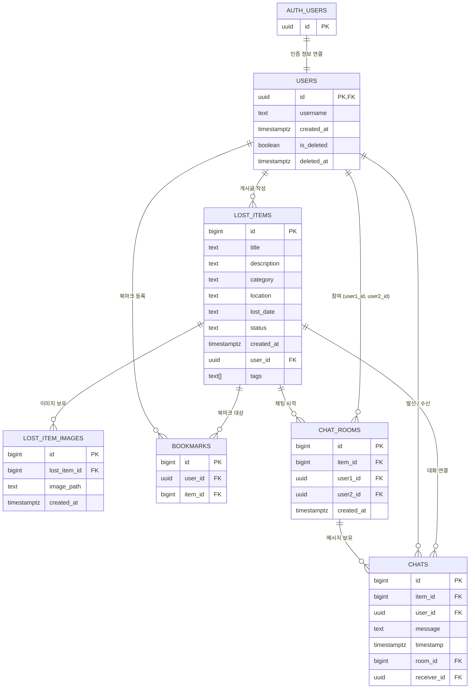

# Supabase 데이터베이스 설정 가이드

PKNU Finder 프로젝트에서 사용하는 Supabase 데이터베이스의 생성 및 설정 방법을 안내합니다.

이 문서는 Supabase를 처음 사용하는 팀원 또는 기여자도 동일한 데이터베이스 환경을 구성할 수 있도록 작성되었습니다.

> **주의:** 이 문서는 2026-11-05 기준으로 작성되었습니다. 이 문서의 DDL은 새 프로젝트 구성용 예시이며, 이미 운영 중인 DB에 그대로 재실행하면 객체 중복 오류가 날 수 있습니다.

## 목차

1. [Supabase 가입 및 프로젝트 생성](#1-supabase-가입-및-프로젝트-생성)
2. [프로젝트 API 정보 확인](#2-프로젝트-api-정보-확인)
3. [데이터베이스 테이블 생성](#3-데이터베이스-테이블-생성)
4. [테이블 관계 확인](#4-테이블-관계-확인)
5. [RLS(Row Level Security) 설정](#5-rlsrow-level-security-설정)
6. [Supabase Storage 설정](#6-supabase-storage-설정)
7. [Authentication 설정](#7-authentication-설정)
8. [프로젝트 환경 변수 설정](#8-프로젝트-환경-변수-설정)
9. [데이터베이스 연결 확인](#9-데이터베이스-연결-확인)
10. [주의 사항](#10-주의-사항)

---

## 1. Supabase 가입 및 프로젝트 생성

### 1-1. Supabase 가입

Supabase는 PostgreSQL 기반의 데이터베이스와 사용자 인증, 파일 저장소 등의 기능을 제공하는 서비스입니다.

1. [Supabase 공식 홈페이지](https://supabase.com/)에 접속합니다.
2. **Start your project** 또는 회원가입 버튼을 클릭합니다.
3. GitHub 계정 또는 이메일을 이용하여 회원가입을 진행합니다.
4. 가입이 완료되면 Supabase Dashboard에 접속합니다.

### 1-2. Organization 생성

Supabase 프로젝트를 관리할 Organization을 생성합니다.

1. Dashboard에서 Organization 생성 메뉴를 선택합니다.
2. Organization 이름을 입력합니다.
   - 예시: `PKNU-Finder`
3. 적절한 요금제를 선택합니다.
4. Organization 생성을 완료합니다.

### 1-3. 프로젝트 생성

Organization 생성 후 데이터베이스 프로젝트를 생성합니다.

1. **New Project** 버튼을 클릭합니다.
2. 다음 정보를 입력합니다.

| 항목 | 설정 예시 |
|---|---|
| Project Name | pknu-finder |
| Database Password | 직접 생성한 안전한 비밀번호 |
| Region | Northeast Asia (Seoul) 등 가까운 지역 |
| Pricing Plan | 프로젝트 상황에 맞는 요금제 |

3. Database Password는 별도로 안전하게 보관합니다.
4. **Create new project** 버튼을 클릭합니다.
5. 프로젝트 생성이 완료될 때까지 기다립니다.

`Database Password는 PostgreSQL 데이터베이스에 직접 접속할 때 사용하는 비밀번호입니다. 프로젝트의 API Key와는 다른 정보이므로 혼동하지 않도록 합니다.`


---

## 2. 프로젝트 API 정보 확인

Streamlit 애플리케이션이 Supabase에 연결하려면 프로젝트 URL과 API Key가 필요합니다.

### 2-1. Project URL 확인

1. Supabase Dashboard에서 생성한 프로젝트를 선택합니다.
2. **Project Overview**로 이동합니다.
3. 프로젝트 명 아래에 위치한 Project URL을 확인합니다.
4. 해당 URL을 복사합니다.

예시:

```text
https://abcdefghijklmnop.supabase.co
```

### 2-2. API Key 확인

같은 설정 화면에서 API Key를 확인합니다.

프로젝트에서 사용하는 주요 키는 다음과 같습니다.

| 키 | 용도 |
|---|---|
| Publishable Key | 일반적인 클라이언트 요청에 사용하는 공개 키 |
| Secret Key | 서버 측에서 높은 권한이 필요한 작업에 사용하는 비밀 키 |
| Legacy `anon` Key | 기존 공개 API Key |
| Legacy `service_role` Key | 서버 측 관리자 작업에 사용하는 높은 권한의 비밀 키 |

현재 프로젝트의 기존 설정에서는 `SUPABASE_ANON_KEY`와 `SUPABASE_SERVICE_ROLE_KEY` 등의 환경 변수명을 사용하고 있으며, `DB/database.py`는 두 키를 역할에 따라 명확히 분리하여 사용합니다.


- `service_role` 또는 `Secret Key`는 RLS 정책을 우회할 수 있는 높은 권한의 키입니다. GitHub 저장소, 프론트엔드 코드, 사용자에게 노출되는 화면 등에 절대 공개하면 안 됩니다.

---

## 3. 데이터베이스 테이블 생성

PKNU Finder에서는 사용자 정보 `users`, 분실물 게시글 `lost_items`, 이미지 경로 `lost_item_images`, 북마크 `bookmarks`, 채팅방 `chat_rooms`, 채팅 메시지 `chats` 총 6개의 테이블을 관리합니다.

> 외래 키 관계를 고려하여 `users` → `lost_items` → (`lost_item_images`, `bookmarks`, `chat_rooms`) → `chats` 순서로 생성합니다. `users.id`는 먼저 생성된 `auth.users`의 UUID를 참조합니다.

테이블은 Supabase Dashboard의 SQL Editor에서 SQL 명령어를 실행하여 생성합니다.

### 3-1. SQL Editor 접속

1. Supabase Dashboard에서 프로젝트를 선택합니다.
2. 왼쪽 메뉴에서 **SQL Editor**를 클릭합니다.
3. **New Query**를 클릭합니다.
4. 아래 SQL을 입력합니다.
5. **Run** 버튼을 클릭합니다.

### 3-2. users 테이블

사용자 계정의 기본 정보를 저장하는 테이블입니다.

Supabase Authentication에서 관리하는 사용자 ID와 연결하여 사용합니다.

| 컬럼 | 자료형 | 제약 조건 | 설명 |
|---|---|---|---|
| id | UUID | PK, FK | Supabase Auth 사용자 ID |
| username | TEXT | NOT NULL | 사용자 이름(닉네임) |
| created_at | TIMESTAMPTZ | DEFAULT NOW() | 계정 생성 시각 |
| is_deleted | BOOLEAN | NOT NULL, DEFAULT FALSE | 회원 탈퇴 여부 |
| deleted_at | TIMESTAMPTZ | - | 회원 탈퇴 시각 |

```sql
CREATE TABLE public.users (
    id UUID PRIMARY KEY REFERENCES auth.users(id) ON DELETE CASCADE,
    username TEXT NOT NULL,
    created_at TIMESTAMPTZ DEFAULT NOW(),
    is_deleted BOOLEAN NOT NULL DEFAULT FALSE,
    deleted_at TIMESTAMPTZ
);

CREATE UNIQUE INDEX users_username_unique ON public.users (username);
```

**중요 사항**

- 사용자의 실제 인증 정보는 `auth.users`에서 관리합니다.
- `public.users`는 서비스에서 필요한 사용자 정보를 관리하기 위한 테이블입니다.
- `users.id`에는 Supabase Auth에서 발급한 UUID를 사용합니다.
- 별도의 숫자형 사용자 ID를 발급하여 사용하지 않습니다.
- `auth.users`의 행이 삭제되면 `users`의 행도 함께 삭제됩니다. (`ON DELETE CASCADE`)
- 로그인(이메일, Google, GitHub)에 성공하면 앱이 `id`, `username`을 `users`에 저장(upsert)합니다.
- 회원 탈퇴는 행을 삭제하지 않고 `is_deleted = TRUE`, `deleted_at`을 기록하는 방식(Soft Delete)입니다. `is_deleted`가 `TRUE`인 계정은 다시 로그인할 수 없습니다. (10-2 참고)
- 닉네임 중복은 앱의 `is_nickname_available()`에서 대소문자 구분 없이 검사합니다. DB에는 `users_username_unique` UNIQUE 인덱스가 있어 **대소문자가 같은 정확한 문자열**의 중복을 차단합니다.

### 3-3. lost_items 테이블

분실물 및 습득물 게시글을 저장하는 테이블입니다.

| 컬럼 | 자료형 | 제약 조건 | 설명 |
|---|---|---|---|
| id | BIGINT | PK, IDENTITY | 게시글 고유 ID |
| title | TEXT | NOT NULL | 게시글 제목 |
| description | TEXT | - | 상세 설명 |
| category | TEXT | NOT NULL | 물품 카테고리 |
| location | TEXT | - | 분실 또는 습득 장소 |
| lost_date | TEXT | - | 분실 또는 습득 날짜 |
| status | TEXT | DEFAULT '습득' | 게시글 상태 |
| created_at | TIMESTAMPTZ | DEFAULT NOW() | 게시글 작성 시각 |
| user_id | UUID | FK | 게시글 작성자 ID |
| tags | TEXT[] | NOT NULL, DEFAULT '{}' | 게시글 태그 목록 |

```sql
CREATE TABLE public.lost_items (
    id BIGINT GENERATED BY DEFAULT AS IDENTITY PRIMARY KEY,
    title TEXT NOT NULL,
    description TEXT,
    category TEXT NOT NULL,
    location TEXT,
    lost_date TEXT,
    status TEXT DEFAULT '습득',
    created_at TIMESTAMPTZ DEFAULT NOW(),
    user_id UUID REFERENCES public.users(id) ON DELETE SET NULL,
    tags TEXT[] NOT NULL DEFAULT '{}'
);
```

**주요 사항**

- `id`는 게시글마다 자동으로 생성되는 고유 번호입니다.
- `user_id`는 게시글을 작성한 사용자의 UUID이며, 작성자와 사용자 정보를 연결합니다.
- `status`의 기본값은 `습득`입니다. 앱은 등록 화면의 `분실물`/`습득물` 선택을 `분실`/`습득`으로 변환해 저장하고, 검색도 이 값으로 필터링합니다. DB에는 허용값을 제한하는 CHECK 제약이 없으므로 코드에서 이 두 값을 통일해 사용해야 합니다.
- `lost_date`는 TEXT이므로 `YYYY-MM-DD` 형식의 문자열로 저장합니다. (Python에서는 `date.isoformat()`)
- `category`에는 등록 화면의 카테고리 목록 값(예: 전자기기, 지갑·카드·신분증 등)이 저장됩니다.
- `tags`는 문자열 배열이며, 등록 화면에서는 최대 10개까지 입력할 수 있습니다.
- 작성자(`users`)의 행이 삭제되면 `user_id`는 NULL로 바뀝니다. (`ON DELETE SET NULL`)
- 채팅방(`chat_rooms`)이 있는 게시글은 바로 삭제할 수 없습니다. (3-9 참고)

### 3-4. lost_item_images 테이블

게시글에 첨부된 이미지의 경로를 저장하는 테이블입니다.

이미지 파일 자체를 데이터베이스에 저장하지 않고, Supabase Storage `lost-item-images`에 업로드한 뒤 해당 파일의 경로만 저장합니다.

| 컬럼 | 자료형 | 제약 조건 | 설명 |
|---|---|---|---|
| id | BIGINT | PK, IDENTITY | 이미지 데이터 고유 ID |
| lost_item_id | BIGINT | FK, NOT NULL | 연결된 게시글 ID |
| image_path | TEXT | NOT NULL | Storage에 저장된 이미지 경로 |
| created_at | TIMESTAMPTZ | DEFAULT NOW() | 이미지 등록 시각 |

```sql
CREATE TABLE public.lost_item_images (
    id BIGINT GENERATED BY DEFAULT AS IDENTITY PRIMARY KEY,
    lost_item_id BIGINT NOT NULL
        REFERENCES public.lost_items(id)
        ON DELETE CASCADE,
    image_path TEXT NOT NULL,
    created_at TIMESTAMPTZ DEFAULT NOW()
);
```

**주요 사항**

- 하나의 게시글에 여러 이미지를 등록할 수 있습니다.
- `lost_item_id`를 이용하여 게시글과 이미지를 연결합니다.
- 실제 이미지 파일은 Supabase Storage에서 별도로 관리합니다.
- 게시글이 삭제되면 연결된 이미지 경로 데이터도 함께 삭제됩니다. (`ON DELETE CASCADE`)

### 3-5. bookmarks 테이블

사용자가 관심 있는 게시글을 북마크한 정보를 저장합니다.

| 컬럼 | 자료형 | 제약 조건 | 설명 |
|---|---|---|---|
| id | BIGINT | PK, IDENTITY | 북마크 고유 ID |
| user_id | UUID | FK, NOT NULL | 북마크한 사용자 ID |
| item_id | BIGINT | FK, NOT NULL | 북마크한 게시글 ID |

```sql
CREATE TABLE public.bookmarks (
    id BIGINT GENERATED BY DEFAULT AS IDENTITY PRIMARY KEY,
    user_id UUID NOT NULL REFERENCES public.users(id) ON DELETE CASCADE,
    item_id BIGINT NOT NULL REFERENCES public.lost_items(id) ON DELETE CASCADE,
    CONSTRAINT bookmarks_user_item_unique UNIQUE (user_id, item_id)
);
```

**주요 사항**

- 사용자와 게시글의 관계를 관리합니다.
- `user_id`는 북마크를 등록한 사용자, `item_id`는 북마크 대상 게시글입니다.
- `(user_id, item_id)`의 UNIQUE 제약 `bookmarks_user_item_unique`가 동일 게시글의 중복 북마크를 차단합니다. (3-10 참고)
- 사용자 또는 게시글이 삭제되면 관련 북마크도 함께 삭제됩니다. (`ON DELETE CASCADE`)
- 회원 탈퇴(Soft Delete) 시에는 앱이 해당 사용자의 북마크를 직접 삭제합니다.

### 3-6. chat_rooms 테이블

게시글을 기준으로 두 사용자 사이의 채팅방 정보를 저장합니다. 개별 메시지는 `chats` 테이블에 저장합니다.

| 컬럼 | 자료형 | 제약 조건 | 설명 |
|---|---|---|---|
| id | BIGINT | PK, IDENTITY | 채팅방 고유 ID |
| item_id | BIGINT | FK, NOT NULL | 채팅이 시작된 게시글 ID |
| user1_id | UUID | FK, NOT NULL | 채팅 참여자 1의 사용자 ID |
| user2_id | UUID | FK, NOT NULL | 채팅 참여자 2의 사용자 ID |
| created_at | TIMESTAMPTZ | NOT NULL, DEFAULT NOW() | 채팅방 생성 시각 |

```sql
CREATE TABLE public.chat_rooms (
    id BIGINT GENERATED BY DEFAULT AS IDENTITY PRIMARY KEY,
    item_id BIGINT NOT NULL REFERENCES public.lost_items(id),
    user1_id UUID NOT NULL REFERENCES public.users(id),
    user2_id UUID NOT NULL REFERENCES public.users(id),
    created_at TIMESTAMPTZ NOT NULL DEFAULT NOW(),
    CONSTRAINT chat_rooms_different_users CHECK (user1_id <> user2_id)
);

CREATE UNIQUE INDEX chat_rooms_unique_conversation
ON public.chat_rooms (item_id, LEAST(user1_id, user2_id), GREATEST(user1_id, user2_id));
```

**주요 사항**

- `item_id`로 어떤 게시글에서 시작된 채팅방인지 구분합니다.
- `user1_id`, `user2_id`는 채팅방에 참여하는 두 사용자입니다. 어느 쪽이 먼저 들어가는지에 대한 규칙은 없으므로, 조회할 때는 두 순서를 모두 고려해야 합니다.
- `item_id`, `user1_id`, `user2_id`의 삭제 규칙은 `NO ACTION`입니다. 따라서 채팅방이 남아 있는 게시글이나 사용자는 삭제할 수 없고, 채팅방을 삭제하려면 해당 채팅방의 `chats` 메시지를 먼저 삭제해야 합니다. (3-9 참고)
- 자기 자신과의 채팅방 생성을 막는 CHECK와, 사용자 순서에 관계없이 같은 게시글에서 동일한 두 사용자의 중복 채팅방 생성을 막는 UNIQUE 표현식 인덱스가 적용되어 있습니다. (3-10 참고)

### 3-7. chats 테이블

채팅방 안에서 주고받은 개별 메시지를 저장합니다.

| 컬럼 | 자료형 | 제약 조건 | 설명 |
|---|---|---|---|
| id | BIGINT | PK, IDENTITY | 메시지 고유 ID |
| item_id | BIGINT | FK, NOT NULL | 관련 게시글 ID |
| user_id | UUID | FK, NOT NULL | 메시지 작성자(발신자) ID |
| message | TEXT | NOT NULL | 메시지 내용 |
| timestamp | TIMESTAMPTZ | DEFAULT NOW() | 메시지 작성 시각 |
| room_id | BIGINT | FK, NOT NULL | 메시지가 속한 채팅방 ID |
| receiver_id | UUID | FK, NOT NULL | 메시지 수신자 ID |

```sql
CREATE TABLE public.chats (
    id BIGINT GENERATED BY DEFAULT AS IDENTITY PRIMARY KEY,
    item_id BIGINT NOT NULL REFERENCES public.lost_items(id) ON DELETE CASCADE,
    user_id UUID NOT NULL REFERENCES public.users(id) ON DELETE CASCADE,
    message TEXT NOT NULL,
    timestamp TIMESTAMPTZ DEFAULT NOW(),
    room_id BIGINT NOT NULL REFERENCES public.chat_rooms(id),
    receiver_id UUID NOT NULL REFERENCES public.users(id)
);
```

**주요 사항**

- `room_id`로 메시지가 속한 채팅방을 구분합니다. 메시지를 조회할 때는 `item_id`가 아니라 `room_id`를 기준으로 해야 서로 다른 채팅방의 대화가 섞이지 않습니다.
- `item_id`는 `chat_rooms.item_id`와 같은 값을 저장해야 합니다. (DB가 이를 강제하지는 않습니다.)
- `user_id`는 발신자, `receiver_id`는 수신자입니다.
- 메시지 작성 시각은 `timestamp`에 저장되며 자료형은 TIMESTAMPTZ입니다.
- 삭제 규칙은 `item_id`, `user_id`가 `CASCADE`, `room_id`, `receiver_id`가 `NO ACTION`입니다. (3-9 참고)

### 3-8. 앱에서 사용하는 값 정리

| 항목 | 값 | 사용 위치 |
|---|---|---|
| `lost_items.status` | `분실`, `습득` | 게시글 등록, 검색 필터 |
| `lost_items.lost_date` | `YYYY-MM-DD` 문자열 | 게시글 등록 |
| `lost_items.tags` | 문자열 배열(최대 10개) | 게시글 등록 |
| Storage 경로(`image_path`) | `{게시글 ID}/{랜덤 hex}.{jpg\|jpeg\|png}` | 이미지 업로드 |
| 탈퇴 계정 닉네임 | `탈퇴한 유저_{사용자 ID 앞 8자리}` | 회원 탈퇴 |

### 3-9. 외래 키 삭제 규칙

2026-11-05 실제 DB에서 확인한 외래 키의 삭제 규칙입니다.

| 컬럼 | 참조 대상 | 삭제 규칙 |
|---|---|---|
| users.id | auth.users.id | CASCADE |
| lost_items.user_id | users.id | SET NULL |
| lost_item_images.lost_item_id | lost_items.id | CASCADE |
| bookmarks.user_id | users.id | CASCADE |
| bookmarks.item_id | lost_items.id | CASCADE |
| chat_rooms.item_id | lost_items.id | NO ACTION |
| chat_rooms.user1_id | users.id | NO ACTION |
| chat_rooms.user2_id | users.id | NO ACTION |
| chats.item_id | lost_items.id | CASCADE |
| chats.user_id | users.id | CASCADE |
| chats.room_id | chat_rooms.id | NO ACTION |
| chats.receiver_id | users.id | NO ACTION |

`NO ACTION`은 참조하는 행이 남아 있으면 삭제를 거부합니다.

**삭제 시 영향**

- **게시글 삭제**: 이미지 경로(`lost_item_images`)와 북마크는 함께 삭제됩니다. 하지만 `chat_rooms`가 있으면 삭제가 거부되므로 `chats` → `chat_rooms` → `lost_items` 순서로 삭제해야 합니다. Storage의 이미지 파일은 자동으로 삭제되지 않습니다.
- **채팅방 삭제**: 해당 채팅방의 `chats` 메시지를 먼저 삭제해야 합니다.
- **사용자 완전 삭제(Hard Delete)**: `users` 행이 삭제되면 북마크와 보낸 메시지(`chats.user_id`)가 함께 삭제되고 게시글의 `user_id`는 NULL이 됩니다. 단, 채팅방(`chat_rooms`)이나 받은 메시지(`chats.receiver_id`)가 남아 있으면 삭제가 거부됩니다. 현재 앱은 Soft Delete를 사용하므로 해당되지 않습니다. (10-2 참고)

**삭제 규칙 다시 확인하기**

`confdeltype`이 `c`이면 CASCADE, `n`이면 SET NULL, `a`이면 NO ACTION입니다.

```sql
SELECT conrelid::regclass AS table_name, conname, confdeltype
FROM pg_constraint
WHERE contype = 'f' AND connamespace = 'public'::regnamespace
ORDER BY conrelid::regclass::text, conname;
```

### 3-10. 실제 적용된 무결성 제약 및 인덱스

다음 객체는 **이미 데이터베이스에 적용된 상태**입니다. 기존 DB에 아래 DDL을 다시 실행하지 마세요. 3-2~3-6의 `CREATE TABLE` 예시는 신규 환경 구성용이며, 중복 객체는 별도 주의가 필요합니다.

| 기능 | 실제 객체 | 정의 |
|---|---|---|
| 동일 사용자·게시글 북마크 중복 방지 | `bookmarks_user_item_unique` (UNIQUE 제약) | `UNIQUE (user_id, item_id)` |
| 자기 자신과 채팅 방지 | `chat_rooms_different_users` 및 `chat_rooms_users_different` (CHECK 2개) | `CHECK (user1_id <> user2_id)` |
| 동일 게시글·동일 두 사용자 채팅방 중복 방지 | `chat_rooms_unique_conversation` 및 `chat_rooms_unique_pair` (UNIQUE 인덱스 2개) | `(item_id, LEAST(user1_id,user2_id), GREATEST(user1_id,user2_id))` |
| 닉네임의 정확한 중복 방지 | `users_username_unique` (UNIQUE 인덱스) | `(username)` |

`chat_rooms.item_id`, `user1_id`, `user2_id`는 모두 NOT NULL이므로, 참여자 순서가 바뀌어도 동일 게시글·동일 두 사용자 조합은 유일해야 합니다. 다만 현재 자기 자신 방지 CHECK와 채팅방 UNIQUE 표현식 인덱스는 각각 똑같은 정의가 두 개씩 있어 중복 관리 비용이 발생합니다. 객체 정리는 영향 검토 후 별도 마이그레이션으로 수행할 예정입니다.

```sql
-- 실제 적용된 유일성 인덱스 확인 (조회용)
SELECT tablename, indexname, indexdef
FROM pg_indexes
WHERE schemaname = 'public'
ORDER BY tablename, indexname;

-- CHECK 및 UNIQUE 제약 조건 확인 (조회용)
SELECT conrelid::regclass AS table_name, conname,
       pg_get_constraintdef(oid) AS definition
FROM pg_constraint
WHERE connamespace = 'public'::regnamespace
  AND contype IN ('c','u')
ORDER BY table_name, conname;
```

---

## 4. 테이블 관계 확인

PKNU Finder의 데이터베이스는 다음과 같은 관계로 구성됩니다.



### 관계 설명

| 관계 | 설명 |
|---|---|
| auth.users ↔ users | Supabase Auth 사용자와 서비스 사용자 정보 연결 |
| users → lost_items | 한 사용자가 여러 게시글 작성 가능 |
| lost_items → lost_item_images | 한 게시글에 여러 이미지 등록 가능 |
| users → bookmarks | 한 사용자가 여러 게시글 북마크 가능 |
| lost_items → bookmarks | 하나의 게시글을 여러 사용자가 북마크 가능 |
| lost_items → chat_rooms | 하나의 게시글에서 여러 채팅방 생성 가능 |
| users → chat_rooms | 한 사용자가 `user1_id` 또는 `user2_id`로 여러 채팅방에 참여 가능 |
| chat_rooms → chats | 하나의 채팅방에 여러 메시지 연결 가능 |
| users → chats | 한 사용자가 발신자(`user_id`) 또는 수신자(`receiver_id`)로 여러 메시지에 연결 가능 |
| lost_items → chats | 하나의 게시글에 여러 메시지 연결 가능 |

---

## 5. RLS(Row Level Security) 설정

RLS는 데이터베이스의 행 단위 접근 권한을 제어하는 보안 기능입니다.

예를 들어 로그인한 사용자가 자신의 북마크만 조회하거나, 다른 사용자의 게시글을 임의로 수정하지 못하도록 제한할 수 있습니다.

### 5-1. RLS 활성화

현재 PKNU Finder의 6개 테이블은 모두 RLS가 활성화되어 있습니다. (2026-11-05)

새 Supabase 프로젝트를 구성하는 경우 SQL Editor에서 다음 SQL을 실행합니다.

```sql
ALTER TABLE public.users ENABLE ROW LEVEL SECURITY;
ALTER TABLE public.lost_items ENABLE ROW LEVEL SECURITY;
ALTER TABLE public.lost_item_images ENABLE ROW LEVEL SECURITY;
ALTER TABLE public.bookmarks ENABLE ROW LEVEL SECURITY;
ALTER TABLE public.chat_rooms ENABLE ROW LEVEL SECURITY;
ALTER TABLE public.chats ENABLE ROW LEVEL SECURITY;
```

### 5-2. RLS 활성화 상태 확인

다음 SQL을 실행하면 각 테이블의 RLS 활성화 여부를 확인할 수 있습니다.

```sql
SELECT
    tablename,
    rowsecurity
FROM pg_tables
WHERE schemaname = 'public'
ORDER BY tablename;
```

`rowsecurity` 값이 `true`이면 해당 테이블의 RLS가 활성화된 것입니다. 현재는 `bookmarks`, `chat_rooms`, `chats`, `lost_item_images`, `lost_items`, `users` 모두 `true`입니다.

각 테이블에 설정된 정책(Policy)은 다음 SQL로 확인할 수 있습니다.

```sql
SELECT tablename, policyname, cmd, roles
FROM pg_policies
WHERE schemaname = 'public'
ORDER BY tablename, policyname;
```

### 5-3. 실제 적용된 RLS 정책 (2026-11-05)

`public`의 6개 테이블 모두 `relrowsecurity = true`, `relforcerowsecurity = false`입니다. 다음은 현재를 기즌으로 `pg_policies` 조회 결과에 있는 총 16개 정책을 요약한 표입니다. 
아래에서 '본인'은 `auth.uid()`가 해당 행의 사용자 ID와 일치하는 경우를 의미합니다.

| 테이블 | SELECT | INSERT | UPDATE | DELETE |
|---|---|---|---|---|
| `users` | 본인(`id`) | 정책 없음 | 본인(`id`), 변경 후에도 본인 | 정책 없음 |
| `lost_items` | anon·authenticated 전체 | 본인(`user_id`) | 본인(`user_id`), 변경 후에도 본인 | 본인(`user_id`) |
| `lost_item_images` | anon·authenticated 전체 | 연결된 게시글 작성자 | 정책 없음 | 연결된 게시글 작성자 |
| `bookmarks` | 본인(`user_id`) | 본인(`user_id`) | 정책 없음 | 본인(`user_id`) |
| `chat_rooms` | 두 참여자 중 한 명 | 두 참여자 중 한 명 | 정책 없음 | 정책 없음 |
| `chats` | 채팅방 참여자 | 발신자 본인 및 수신자가 방의 다른 참여자 | 정책 없음 | 정책 없음 |

**정확한 정책 조건**

- `users`: SELECT는 `auth.uid() = id`, UPDATE는 `USING`·`WITH CHECK` 모두 `auth.uid() = id`.
- `lost_items`: SELECT는 `true` (`anon`, `authenticated`), INSERT는 `WITH CHECK (auth.uid() = user_id)`, UPDATE는 `USING`·`WITH CHECK` 모두 동일, DELETE는 `USING (auth.uid() = user_id)`.
- `lost_item_images`: SELECT는 `true` (`anon`, `authenticated`). INSERT/DELETE는 `EXISTS (SELECT 1 FROM lost_items li WHERE li.id = lost_item_images.lost_item_id AND li.user_id = auth.uid())`를 각각 `WITH CHECK`/`USING`에 사용.
- `bookmarks`: SELECT/DELETE는 `USING (auth.uid() = user_id)`, INSERT는 `WITH CHECK (auth.uid() = user_id)`.
- `chat_rooms`: SELECT는 `USING (auth.uid() = user1_id OR auth.uid() = user2_id)`, INSERT는 동일 조건을 `WITH CHECK`로 사용.
- `chats`: SELECT는 `room_id`의 `chat_rooms` 행에 현재 사용자가 참여하는 경우 `EXISTS`로 허용. INSERT는 `auth.uid() = chats.user_id`이며, `chat_rooms.id = chats.room_id`인 방에 현재 사용자가 참여하고 `chats.receiver_id`가 방의 *다른* 참여자여야 함.

정책 정의에 포함되지 않은 작업은 통상 RLS에 의해 거부되지만, 실제 결과는 테이블 권한 및 클라이언트의 우회 권한에도 좌우됩니다. `users` INSERT 정책이 없는 것은 `views/mypage/auth.py`에서 관리자 클라이언트로 프로필을 upsert하기 때문입니다.

```sql
-- 정책 상세 확인: USING(qual), WITH CHECK 포함
SELECT tablename, policyname, roles, cmd, qual, with_check
FROM pg_policies
WHERE schemaname = 'public'
ORDER BY tablename, policyname;
```

### 5-4. RLS 및 클라이언트 권한 운용

`DB/database.py`는 세 클라이언트를 분리합니다.

| 함수 | 키 | 세션 / 용도 |
|---|---|---|
| `create_auth_client()` | `SUPABASE_ANON_KEY` | 로그인/회원가입, 로그인 전 인증 작업 |
| `get_supabase_client()` | `SUPABASE_ANON_KEY` | Streamlit 세션의 access/refresh token을 `auth.set_session()`에 적용하고 사용자 ID를 검증한 뒤 일반 DB·Storage 작업 수행 |
| `get_supabase_admin_client()` | `SUPABASE_SERVICE_ROLE_KEY` | 관리자용 캐시 클라이언트, 프로필 upsert/중복 닉네임 확인/회원 탈퇴 등 |

일반 클라이언트는 관리자 키를 우선 사용하지 않습니다. 세션이 없거나 `auth.get_user()`의 ID와 `st.session_state.user_id`가 다르면 예외를 발생시킵니다.

---

## 6. Supabase Storage 설정

PKNU Finder는 게시글에 첨부되는 이미지를 Supabase Storage에 저장합니다.

### 6-1. Storage Bucket 생성

1. Supabase Dashboard에서 프로젝트를 선택합니다.
2. 왼쪽 메뉴에서 **Storage**를 클릭합니다.
3. **New Bucket**을 선택합니다.
4. 다음과 같이 설정합니다.

| 항목 | 설정 |
|---|---|
| Bucket Name | `lost-item-images` |
| Public Bucket | OFF (Private) |
| 버킷별 파일 크기 제한 | `NULL` (별도 지정되지 않음; 프로젝트 전체 제한은 별도 적용 가능) |
| 버킷별 허용 MIME 타입 | `NULL` (별도 지정되지 않음; 앱에서는 jpg/jpeg/png만 허용) |

5. Bucket 생성을 완료합니다.


### 6-2. 이미지 저장 구조

이미지 파일은 Storage에 저장하고, 이미지 경로는 `lost_item_images` 테이블에 저장합니다.

예시:

```text
Supabase Storage
└── lost-item-images
    ├── 1
    │   ├── image_1.jpg
    │   └── image_2.jpg
    └── 2
        └── image_1.jpg
```

데이터베이스에는 다음과 같이 저장됩니다.

| id | lost_item_id | image_path |
|---|---|---|
| 1 | 1 | `1/image_1.jpg` |
| 2 | 1 | `1/image_2.jpg` |
| 3 | 2 | `2/image_1.jpg` |

### 6-3. Storage 접근 권한과 코드의 실제 동작

실제 버킷 `lost-item-images`는 **Private(`public = false`)**, `file_size_limit = NULL`, `allowed_mime_types = NULL`입니다. `storage.objects`는 **RLS 활성화**(`relrowsecurity = true`, `relforcerowsecurity = false`)이고 다음 정책 3개가 있습니다.

| 정책 | 명령 | 역할 | 조건 |
|---|---|---|---|
| Anyone can view lost item images | SELECT | anon, authenticated | `bucket_id = 'lost-item-images'` |
| Users can upload own lost item images | INSERT | authenticated | 버킷이 일치하고 경로 첫 폴더와 동일한 `lost_items.id`의 소유자(`li.user_id`)가 `auth.uid()` |
| Users can delete own lost item images | DELETE | authenticated | INSERT와 동일한 게시글 소유자 검사 |

정확한 INSERT/DELETE 소유권 판정식은 아래와 같습니다. INSERT는 `WITH CHECK`, DELETE는 `USING`에 적용됩니다.

```sql
bucket_id = 'lost-item-images'
AND EXISTS (
  SELECT 1 FROM public.lost_items li
  WHERE li.id::text = (storage.foldername(objects.name))[1]
    AND li.user_id = auth.uid()
)
```

파일 경로는 **`{lost_items.id}/{파일명}`**을 따라야 합니다. `views/register/register.py`의 `upload_item_image()`는 `{item_id}/{uuid4().hex}.{jpg|jpeg|png}`를 생성하여 일반 클라이언트로 업로드하고, `lost_item_images`에 경로를 INSERT합니다. DB 기록 실패 시 업로드 파일 삭제를 재시도합니다.

```sql
-- Storage 버킷 및 정책 다시 확인
SELECT id, name, public, file_size_limit, allowed_mime_types FROM storage.buckets;
SELECT tablename, policyname, roles, cmd, qual, with_check
FROM pg_policies WHERE schemaname='storage' AND tablename='objects';
```

---

## 7. Authentication 설정

PKNU Finder는 Supabase Authentication을 이용하여 사용자 인증을 처리합니다.

### 7-1. 이메일 인증 설정

1. Supabase Dashboard에서 **Authentication** 메뉴로 이동합니다.
2. **Sign In / Providers** 또는 Providers 설정 화면을 엽니다.
3. Email Provider가 활성화되어 있는지 확인합니다.
4. 이메일 인증 사용 여부를 프로젝트 정책에 맞게 설정합니다.

이메일 인증을 활성화하면 회원가입 후 이메일 확인 절차가 필요할 수 있습니다.

### 7-2. Google OAuth 설정

Google 계정으로 로그인할 수 있도록 Google Provider를 설정합니다.

1. Google Cloud Console에서 프로젝트를 생성합니다.
2. OAuth 동의 화면을 설정합니다.
3. OAuth Client ID와 Client Secret을 발급받습니다.
4. Supabase Dashboard의 Authentication → Providers → Google에서 해당 정보를 입력합니다.
5. Supabase에서 제공하는 Callback URL을 Google Cloud Console의 승인된 리디렉션 URI에 등록합니다.
6. 설정을 저장하고 활성화합니다.

### 7-3. GitHub OAuth 설정

GitHub 계정으로 로그인할 수 있도록 GitHub Provider를 설정합니다.

1. GitHub의 Developer Settings로 이동합니다.
2. OAuth Apps에서 새로운 OAuth App을 생성합니다.
3. Application 이름과 Homepage URL을 입력합니다.
4. Authorization callback URL에 Supabase에서 제공하는 Callback URL을 입력합니다.
5. Client ID와 Client Secret을 발급받습니다.
6. Supabase Dashboard의 Authentication → Providers → GitHub에 해당 정보를 입력합니다.
7. Provider를 활성화합니다.

### 7-4. Redirect URL 설정

OAuth 인증이 완료된 후 사용자가 돌아올 주소를 설정합니다.

Supabase Dashboard의 Authentication → URL Configuration에서 다음 항목을 확인합니다.

- Site URL
- Redirect URLs

개발 환경과 배포 환경의 주소를 각각 등록해야 합니다.

예시:

```text
http://localhost:8501
```

---

## 8. 프로젝트 환경 변수 설정

Supabase 프로젝트와 Streamlit 애플리케이션을 연결하기 위해 환경 변수를 설정합니다.

### 8-1. `.streamlit/secrets.toml` 생성

프로젝트 루트에 `.streamlit` 폴더가 있으며, 예시 파일이 포함되어 있습니다.

```text
project/
├── .github
├── .streamlit/
│   ├── secrets.toml.example   # 예시 파일 (Git 포함)
│   └── secrets.toml           # 실제 값 (Git 제외, 직접 생성)
├── main.py
└── ...
```

`secrets.toml.example`을 복사하여 `secrets.toml`을 만들고 다음 내용을 작성합니다.

```toml
SUPABASE_URL = "https://your-project-id.supabase.co"
SUPABASE_ANON_KEY = "your-publishable-or-anon-key"
SUPABASE_SERVICE_ROLE_KEY = "your-secret-service-role-key"
SUPABASE_REDIRECT_URL = "your-redirect-url"
```

실제 프로젝트 URL과 API Key, Redirect URL로 변경해야 합니다.
위 값들을 `[supabase]` 섹션 아래에 같은 이름으로 작성해도 인식됩니다.

### 8-2. 환경 변수 설명

| 변수명 | 설명 |
|---|---|
| SUPABASE_URL | Supabase 프로젝트 URL |
| SUPABASE_ANON_KEY | 공개 API Key |
| SUPABASE_SERVICE_ROLE_KEY | 서버 측 관리자 작업용 비밀 키 |
| SUPABASE_REDIRECT_URL | 리다이렉트 URL 주소 |

**주의 사항**

- `secrets.toml`은 GitHub에 업로드하지 않습니다.
- `.gitignore`에 `.streamlit/secrets.toml`이 포함되어 있는지 확인합니다.
- `SUPABASE_SERVICE_ROLE_KEY`는 Streamlit 서버 내부에서만 사용합니다.
- 키를 코드에 직접 작성하지 않습니다.

`.gitignore` 예시:

```gitignore
.streamlit/secrets.toml
.env
```

### 8-3. Python 패키지 설치

프로젝트에 작성된 `requirements.txt` 파일을 기준으로 패키지를 설치합니다.

```bash
pip install -r requirements.txt
```

---

## 9. 데이터베이스 연결 확인

환경 변수 설정이 끝났다면 애플리케이션에서 Supabase 연결을 확인합니다.

### 9-1. 초기화와 로그인 후 조회 테스트

`init_db()`는 **로그인 없이** `create_auth_client()`를 생성해 설정을 점검할 뿐, DB 질의를 수행하지 않습니다.

```python
from DB.database import init_db
init_db()  # URL/anon 키 등 클라이언트 설정 점검
```

실제 SELECT 및 RLS 동작은 앱에서 로그인해 `st.session_state`에 access/refresh token과 `user_id`가 설정된 이후 확인합니다.

```python
from DB.database import get_supabase_client
client = get_supabase_client()  # 로그인 세션 필수
print(client.table("users").select("id,username").limit(1).execute().data)
```

이 조회는 로그인한 본인의 `users` 행만 반환하도록 RLS가 설계되어 있습니다. 관리자 키 클라이언트를 테스트에 사용하면 RLS 검증이 되지 않습니다.

### 9-2. 테이블 생성 여부 확인

Supabase Dashboard의 **Table Editor**로 이동합니다.

다음 테이블이 생성되어 있는지 확인합니다.

- `users`
- `lost_items`
- `lost_item_images`
- `bookmarks`
- `chat_rooms`
- `chats`

각 테이블을 클릭하여 컬럼과 자료형이 올바르게 설정되었는지 확인합니다.

### 9-3. Storage 확인

Storage 메뉴에서 다음 항목을 확인합니다.

- `lost-item-images` Bucket이 생성되어 있는가?
- Bucket이 Private으로 설정되어 있는가?
- 테스트 이미지 업로드가 정상적으로 수행되는가?
- 업로드한 파일의 경로가 `lost_item_images` 테이블에 저장되는가?

### 9-4. Authentication 확인

Authentication → Users에서 회원가입한 사용자가 등록되는지 확인합니다.

Google, GitHub, 이메일 회원가입을 각각 테스트하고, 인증된 사용자의 UUID가 `public.users`에도 정상적으로 등록되는지 확인합니다.

---

## 10. 주의 사항

### 10-1. 사용자 ID는 UUID 사용

숫자형 사용자 ID 대신 Supabase Auth에서 발급하는 UUID를 사용합니다.

```text
auth.users.id
      │
      ▼
public.users.id
      │
      ├── lost_items.user_id
      ├── bookmarks.user_id
      ├── chat_rooms.user1_id
      ├── chat_rooms.user2_id
      ├── chats.user_id
      └── chats.receiver_id
```

따라서 사용자 관련 외래 키의 자료형도 `UUID`로 통일해야 합니다.

### 10-2. 회원 탈퇴 시 관련 데이터 처리

현재 회원 탈퇴는 데이터를 삭제하지 않고 계정을 비활성화하는 방식(Soft Delete)으로 구현되어 있습니다. (`views/mypage/auth.py`의 `delete_user`)

| 대상 | 처리 내용 |
|---|---|
| users | 행은 유지하고 `username`을 `탈퇴한 유저_{ID 앞 8자리}`로 변경, `is_deleted = TRUE`, `deleted_at` 기록 |
| bookmarks | 해당 사용자의 북마크 삭제 |
| auth.users | Supabase Auth 계정 Soft Delete |
| lost_items | 유지 (작성자 이름은 `탈퇴한 유저`로 표시) |
| lost_item_images | 유지 |
| chat_rooms, chats | 유지 |

- `users` 행이 남아 있으므로 `lost_items`, `chat_rooms`, `chats`의 외래 키가 깨지지 않습니다.
- `is_deleted`가 `TRUE`인 계정은 로그인 시 `탈퇴 처리된 계정입니다.`로 차단되어 같은 계정으로 다시 가입·로그인할 수 없습니다.
- Auth 계정을 완전히 삭제(Hard Delete)하는 방식으로 바꾸려면 삭제 규칙(3-9)을 먼저 검토해야 합니다. 채팅방이나 받은 메시지가 남아 있는 사용자는 `NO ACTION` 때문에 삭제가 거부됩니다.

### 10-3. 관리자 키 보안

`service_role` 키는 일반 사용자보다 높은 권한을 가지고 있습니다.

따라서 다음 사항을 반드시 지켜야 합니다.

- GitHub에 관리자 키를 업로드하지 않습니다.
- 프론트엔드 또는 사용자에게 노출되는 코드에 포함하지 않습니다.
- 서버 측 관리자 작업에만 사용합니다.
- 사용자의 요청을 처리할 때 서버에서 사용자 권한을 검증합니다.

### 10-4. 데이터베이스 변경 시 주의

기존 테이블의 컬럼명이나 자료형을 변경하면 Python 코드의 쿼리도 함께 수정해야 합니다.

특히 다음 파일을 확인합니다.

- `main.py`
- `DB/database.py`
- `views/mypage/auth.py` (로그인, 회원가입, 회원 탈퇴)
- `views/mypage/mypage.py`
- `views/register/register.py` (게시글 등록, 이미지 업로드)
- `views/search/search_service.py` (게시글 검색)
- 채팅 관련 파일 (개발 중)

DB 구조와 Python 코드가 일치하지 않으면 데이터 조회 및 등록 과정에서 오류가 발생할 수 있습니다.

---

## 참고 자료

- [Supabase 공식 홈페이지](https://supabase.com/)
- [Supabase Database 문서](https://supabase.com/docs/guides/database/overview)
- [Supabase Tables 문서](https://supabase.com/docs/guides/database/tables)
- [Supabase Authentication 문서](https://supabase.com/docs/guides/auth)
- [Supabase User Management 문서](https://supabase.com/docs/guides/auth/managing-user-data)
- [Supabase Storage 문서](https://supabase.com/docs/guides/storage)

---

**PKNU Finder Database Setup Guide**

이 문서를 따라 Supabase 프로젝트를 생성하고 데이터베이스, 인증, Storage 설정을 완료하면 PKNU Finder의 기본 데이터베이스 환경을 구성할 수 있습니다.

**추가 참고 문서**
- [database.md](database.md): Supabase 가입, 프로젝트 생성, 실제 테이블 스키마, 외래 키, RLS, Storage 및 인증 설정
- [DB_use_guide.md](DB_use_guide.md): 실제 Python 코드에서 데이터를 입력하고 조회하는 방법