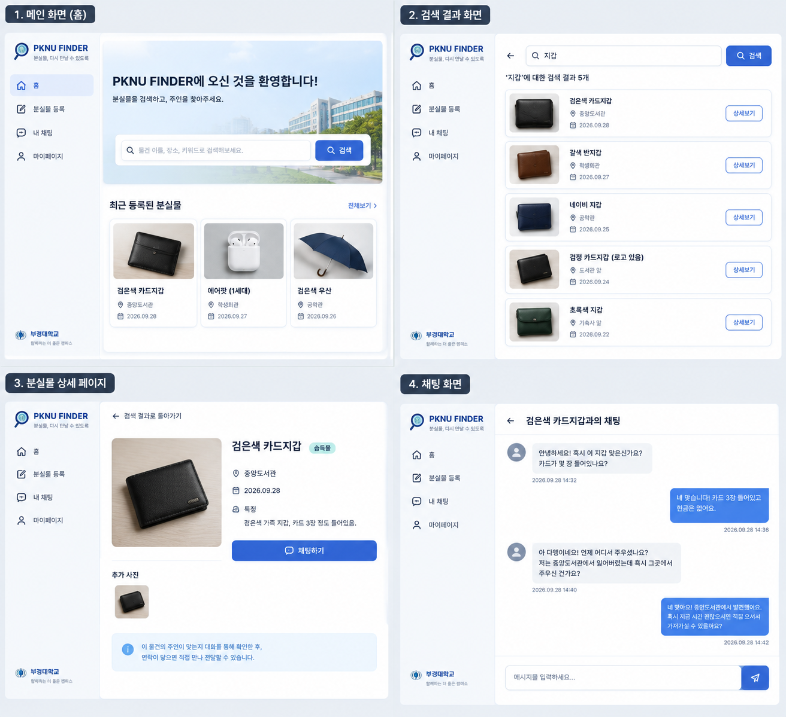

<p align="center">
  
</p>

<h1 align="center">PKNU Finder</h1>

<p align="center">
  부경대학교 학생들을 위한 <strong>분실물·습득물 찾기 서비스</strong>
</p>

잃어버린 물건을 찾고, 주운 물건의 주인을 찾을 수 있도록 돕는 웹 애플리케이션입니다. 분실물·습득물 게시글을 등록하고 검색할 수 있으며, 사용자 인증과 게시글 사진 저장은 Supabase를 통해 관리합니다.

- **애플리케이션:** [Streamlit](https://streamlit.io/)
- **데이터베이스·인증·파일 저장:** [Supabase](https://supabase.com/) (PostgreSQL, Auth, Storage)

## 화면 미리보기



> 위 이미지는 기획 단계의 예상 화면입니다. 실제 구현 상태는 아래 표를 참고해 주세요.

## 구현 현황

| 기능 | 상태 | 설명 | 담당 |
|---|---|---|---|
| 로그인 / 회원가입 | 구현 | 이메일·비밀번호 로그인 및 회원가입, Google·GitHub OAuth 로그인 연결 | 이민범 |
| 로그아웃 | 구현 | 현재 로그인 세션 종료 | 이민범 |
| 회원 탈퇴 | 일부 구현 | 계정 비활성화(Soft Delete), 탈퇴 유저명 변경(탈퇴한 유저_xxx..) 구현, 북마크, 게시글, 채팅 등 사용자 데이터 삭제 기능 구현 예정 | 이민범 |
| 분실물 / 습득물 등록 | 구현 | 유형, 제목, 카테고리, 장소, 날짜, 설명, 태그 및 사진 등록 | 윤한희 |
| 분실물 / 습득물 검색 | 기본 기능 구현 | 키워드 검색 및 전체·분실물·습득물 유형 필터링 | 박유진 |
| 마이페이지 북마크 | 준비 중 | 관심 게시글 저장 및 조회 | 이민범 |
| 채팅 | 일부 구현 | 사용자의 채팅 목록, 채팅방 UI 구현, DB연동 진행 전이라 더미데이터로 일부 구현 / DB 연동 후 메세지 전송, 수신 기능 및 저장기능 구현 예정 | 김채윤 |

※ 소셜 로그인은 Supabase 대시보드에서 해당 Provider와 OAuth 정보를 설정해야 사용할 수 있습니다. 검색은 현재 제목·설명·카테고리 키워드를 기준으로 동작합니다.

## 설치 및 실행

Python 3.12 이상을 권장합니다. 프로젝트는 Python 3.13 환경에서도 테스트했습니다.

### 1. 저장소 복제

```bash
git clone https://github.com/chaeyun-pknu/pknu-finder.git
cd pknu-finder
```

### 2. 패키지 설치

```bash
python -m pip install --upgrade pip
pip install -r requirements.txt
```

### 3. Supabase 접속 정보 설정

앱을 실행하려면 Supabase 프로젝트의 접속 정보가 필요합니다. 보안을 위해 실제 접속 키는 Git 저장소에 포함하지 않습니다.

프로젝트 루트에서 예시 파일을 복사해 `.streamlit/secrets.toml`을 생성합니다.

**macOS / Linux**

```bash
cp .streamlit/secrets.toml.example .streamlit/secrets.toml
```

**Windows (PowerShell)**

```powershell
Copy-Item .streamlit/secrets.toml.example .streamlit/secrets.toml
```

`.streamlit/secrets.toml`에 팀에게 전달받거나 또는 아래 문서를 참고해 값을 입력합니다.
- [DB/database.md](DB/database.md): Supabase 프로젝트, 테이블, RLS, Storage, Authentication 설정
- [DB/DB_use_guide.md](DB/DB_use_guide.md): Python 코드에서 Supabase DB를 사용하는 방법

```toml
SUPABASE_URL = "https://<project-ref>.supabase.co"
SUPABASE_SERVICE_ROLE_KEY = "<service_role 키>"
SUPABASE_ANON_KEY = "<anon 키>"
SUPABASE_REDIRECT_URL = "http://localhost:8501"
```

| 설정값 | 용도 | 확인 위치 |
|---|---|---|
| `SUPABASE_URL` | Supabase 프로젝트 주소 | Supabase Dashboard → Project Settings → API |
| `SUPABASE_SERVICE_ROLE_KEY` | 서버 측 관리자 작업에 사용하는 비밀 키 | Project Settings → API Keys |
| `SUPABASE_ANON_KEY` | 로그인·회원가입 인증 클라이언트에 사용하는 공개 키 | Project Settings → API Keys |
| `SUPABASE_REDIRECT_URL` | OAuth 인증 후 앱으로 돌아올 주소 | 로컬 실행 시 `http://localhost:8501` |

> **보안 주의**
>
> - `SUPABASE_SERVICE_ROLE_KEY`는 높은 권한을 가진 서버 전용 비밀 키입니다. GitHub, 공개 문서, 메신저, 이슈 등에 올리지 마세요.
> - `.streamlit/secrets.toml`은 `.gitignore`에 포함되어 있어야 합니다. 커밋하기 전에 `git status`로 추적 여부를 확인하세요.
> - 키가 외부에 노출되었다면 해당 키를 Supabase 대시보드에서 교체하고, 저장소에 남은 비밀 정보도 제거해야 합니다.
> - 팀 프로젝트의 접속 정보는 프로젝트 담당자에게 안전한 방법으로 전달받으세요.

### 4. 앱 실행

Streamlit 애플리케이션이므로 `python main.py`가 아니라 다음 명령으로 실행합니다.

```bash
streamlit run main.py
```

또는 포트를 명시할 수 있습니다.

```bash
python -m streamlit run main.py --server.port 8501
```

브라우저에서 `http://localhost:8501`에 접속합니다.

## 사용 방법 (중간발표 기준)

1. **회원가입:** 로그인 화면의 회원가입 영역에서 닉네임, 이메일, 비밀번호를 입력합니다. 비밀번호는 영문과 숫자를 포함해 6자 이상이어야 합니다.
2. **로그인:** 이메일·비밀번호 또는 설정된 소셜 로그인 Provider를 이용합니다.
3. **게시글 등록:** 로그인 후 사이드바에서 `분실물/습득물 등록`을 선택합니다. 분실물 또는 습득물 유형, 카테고리, 장소, 날짜, 설명, 태그와 사진을 입력해 등록합니다.
4. **게시글 검색:** `분실물/습득물 검색`에서 전체·분실물·습득물 유형을 선택하고 키워드를 검색합니다.
5. **마이페이지:** 로그인 계정 정보를 확인하고 회원 탈퇴를 진행할 수 있습니다. 북마크 화면은 준비 중입니다.
6. **로그아웃:** 사이드바의 `로그아웃` 버튼을 누릅니다.

### 회원 탈퇴 안내

현재 회원 탈퇴는 계정과 프로필을 즉시 물리적으로 삭제하는 대신 비활성화하는 방식으로 처리합니다.

- `users` 테이블의 사용자 이름은 `탈퇴한 유저_사용자ID일부` 형식으로 변경됩니다.
- `is_deleted`와 `deleted_at`에 탈퇴 상태 및 시각을 기록합니다. Supabase Auth 계정은 Soft Delete 방식으로 처리됩니다.
- 기존 게시글은 유지됩니다.
- 기존 북마크는 삭제됩니다.
- Supabase Auth 계정은 Soft Delete 방식으로 처리됩니다.

## Supabase 프로젝트 설정

팀에서 사용하는 Supabase 프로젝트에 이미 테이블과 Storage가 구성되어 있다면 별도 생성 작업은 필요하지 않습니다. 새 Supabase 프로젝트를 직접 구성하는 경우 아래 문서를 순서대로 참고하세요.

- [DB/database.md](DB/database.md): Supabase 프로젝트, 테이블, RLS, Storage, Authentication 설정
- [DB/DB_use_guide.md](DB/DB_use_guide.md): Python 코드에서 Supabase DB를 사용하는 방법

### 앱에서 사용하는 주요 테이블

| 테이블 | 용도 |
|---|---|
| `users` | Supabase Auth 사용자와 연결되는 서비스 프로필 및 탈퇴 상태 |
| `lost_items` | 분실물·습득물 게시글 |
| `lost_item_images` | 게시글 사진의 Storage 경로 |
| `bookmarks` | 사용자별 북마크 |
| `chat_rooms` | 게시글별 사용자 간 채팅방 |
| `chats` | 채팅 메시지 |

게시글 사진은 데이터베이스에 이미지 파일 자체를 저장하지 않고 Supabase Storage에 업로드합니다. Storage에는 `lost-item-images` Bucket이 필요합니다.

### Authentication 설정

Supabase Dashboard에서 다음 항목을 확인합니다.

1. **Authentication → URL Configuration**
   - Site URL: `http://localhost:8501`
   - Redirect URLs: `http://localhost:8501/`
2. **Authentication → Providers**
   - Email Provider를 활성화합니다.
   - Google 또는 GitHub 로그인을 사용할 경우 각 Provider를 활성화하고 OAuth Client 정보도 설정합니다.
3. 이메일 인증을 사용하는 경우 가입 후 인증 메일 확인이 필요할 수 있습니다. 데모 환경에서 인증 절차를 생략할지는 팀의 보안·운영 정책에 따라 결정하세요.

포트를 변경해 실행한다면 Supabase의 Redirect URLs와 `SUPABASE_REDIRECT_URL`도 동일한 주소로 변경해야 합니다.

## 문제 해결

| 증상 | 확인 사항 |
|---|---|
| `Supabase 연결 설정이 필요합니다` | `.streamlit/secrets.toml` 파일 존재 여부와 `SUPABASE_URL`, 키 설정 확인 |
| `Supabase 데이터베이스를 확인하지 못했습니다` | `users` 테이블 존재 여부, 테이블 접근 권한, Supabase 키 확인 |
| `streamlit` 명령을 찾을 수 없음 | 가상환경 활성화 및 패키지 설치 여부 확인. `python -m streamlit run main.py`로 실행 가능 |
| 게시글 등록 시 컬럼 관련 오류 | `DB/database.md`의 테이블 정의와 실제 Supabase 컬럼이 일치하는지 확인 |
| 사진 업로드 오류 | Storage에 `lost-item-images` Bucket이 생성되어 있는지, 업로드 권한과 경로 확인 |
| 소셜 로그인 후 앱으로 돌아오지 않음 | Provider 설정, OAuth Redirect URI, Supabase Redirect URLs, `SUPABASE_REDIRECT_URL` 확인 |
| 회원가입 후 바로 로그인되지 않음 | Email Provider의 이메일 인증 설정 및 인증 메일 확인 |
| `8501` 포트가 이미 사용 중 | 다른 포트로 실행하고 `SUPABASE_REDIRECT_URL` 및 Supabase Redirect URLs도 같은 포트로 변경 |

## 프로젝트 구조

```text
pknu-finder/
├── main.py
├── requirements.txt
├── .streamlit/
│   ├── secrets.toml.example
│   └── secrets.toml             # 로컬 전용, Git에 포함하지 않음
├── DB/
│   ├── database.py              # Supabase 클라이언트 및 연결 헬퍼
│   ├── database.md              # Supabase 프로젝트·DB 설정 가이드
│   └── DB_use_guide.md          # Python DB 사용 가이드
├── views/
│   ├── home/
│   │   └── home.py
│   ├── register/
│   │   ├── register.py
│   │   └── register.css
│   ├── search/
│   │   ├── search.py
│   │   └── search_service.py
│   ├── chat/
│   │   ├── chat.py
|   |   └── chat.css
│   └── mypage/
│       ├── auth.py
│       ├── mypage.py
│       └── social_button.py
├── docs/
│   ├── images/
│   ├── meetings/
│   ├── members/
│   └── team-agreement.md
├── CONTRIBUTING.md
├── CODE_OF_CONDUCT.md
└── LICENSE
```

## 팀원

| 이름 | 역할 | GitHub |
|---|---|---|
| 김채윤 | 팀장 | [chaeyun-pknu](https://github.com/chaeyun-pknu) |
| 이민범 | 개발 리드 | [alsqja03](https://github.com/alsqja03), [GuReum03](https://github.com/GuReum03) |
| 박유진 | 문서 담당 | [yujinsutu](https://github.com/yujinsutu) |
| 윤한희 | 리뷰·품질 담당 | [yoonhanhee](https://github.com/yoonhanhee) |

기여 방법은 [CONTRIBUTING.md](CONTRIBUTING.md), 행동 수칙은 [CODE_OF_CONDUCT.md](CODE_OF_CONDUCT.md)를 참고하세요.

## 참고 자료

- [Streamlit 공식 문서](https://docs.streamlit.io/)
- [Supabase 공식 문서](https://supabase.com/docs)
- [Supabase Python Client](https://supabase.com/docs/reference/python/introduction)
- [Supabase Auth 문서](https://supabase.com/docs/guides/auth)

## 라이선스

[MIT License](LICENSE)